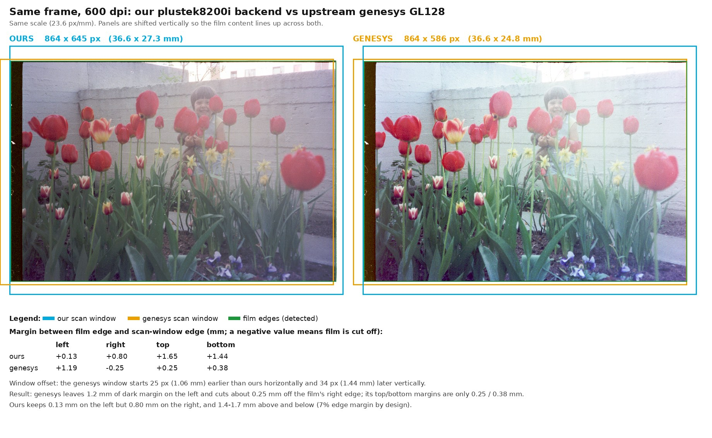
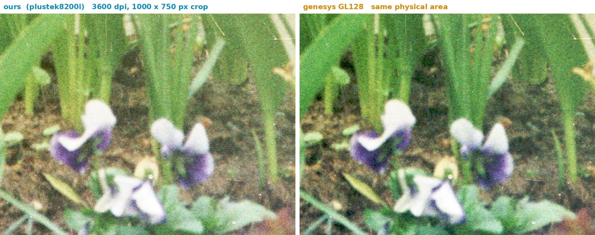

# plustek8200i — SANE backend for the Plustek OpticFilm 8200i (GL128)

[](https://github.com/cschalle/OpticFilm8200i-sane/actions/workflows/rpm.yml)

A [SANE](http://www.sane-project.org/) backend for the Plustek OpticFilm 8200i
film scanner with the Genesys **GL128** controller, USB ID `07b3:1825`. It
works with any SANE frontend (`scanimage`, XSane, Simple Scan, ...).

> **Check your scanner's USB ID first.** An older scanner is sold under the
> same name but reports `07b3:130d` and uses a GL845. That one is supported by
> SANE's own `genesys` backend, not by this one. Run `lsusb` to see which you
> have.

## What it does

The OpticFilm 8200i is a transparency-only scanner for 35 mm film. This
backend provides:

- modes **Color**, **Gray**, **Infrared** and **Color+Infrared**;
- resolutions 300, 600, 1200, 2400, 3600 (default) and 7200 dpi;
- 8 or 16 bits per channel;
- optional dust and scratch removal from the infrared channel (`--ir-clean`);
- an exposure multiplier (1.0 to 4.0) for dense negatives and dark slides;
- a scan window inside the film frame.

The image is delivered as the scanner measured it, after shading correction.
The backend does not invert negatives or apply a gamma curve or colour
profile; do that in your frontend or image editor.

## Status and limitations

The backend was developed and verified against a single scanner. It scans one
frame per start, with the film holder positioned by hand. The scanner itself
takes 35 mm film only (strips and mounted slides), and the backend covers its
whole scan area. The full list is in the **LIMITATIONS** section of the manual
page (`man sane-plustek8200i`). It is not part of the upstream SANE project.

## How it was developed

The protocol was worked out by observing USB captures of the vendor's software
(macOS and Windows) and by measurements on the hardware. The vendor's driver
was only studied to understand the scanner's behaviour; no code from it is
used in this backend.

## Comparison with SANE's genesys backend

Upstream SANE's `genesys` backend gained support for this scanner in September 2026
(it lists it as the "Plustek OpticFilm 8200i SE", the same USB ID `07b3:1825`). This
backend was developed independently and has not been submitted upstream. If both are
installed, `scanimage -L` lists the scanner twice, as `plustek8200i:...` and
`genesys:...`; choose one with `-d`.

The same colour negative, scanned once with each backend on the same unit, and put
through the same negative conversion (`nv-cli render` from the Negative Vibes
scanning application):



At full resolution (3600 dpi) both resolve the same fine detail; this is the same
physical area cut from each scan:



| | this backend | genesys GL128 |
|---|---|---|
| Full frame, 600 dpi | 864 x 645 px, 16.7 s | 864 x 586 px, 16.4 s |
| Full frame, 3600 dpi | 5184 x 3877 px, 34.6 s | 5184 x 3519 px, 54.4 s |
| Infrared channel, dust and scratch removal | yes | no |
| Bit depth | 8 or 16 | 16 |
| Resolutions | 6 (300 to 7200 dpi) | 11 (150 to 7200 dpi) |
| Film margin left / right (mm, 3600 dpi) | 0.17 / 0.85 | 1.19 / 0.06 |
| Film margin top / bottom (mm, 3600 dpi) | 1.64 / 1.56 | 0.45 / 0.22 |

Genesys's scan window sits about 1.06 mm to the left of this backend's and leaves less
room above and below the film, so a small positioning error would clip the picture.
Its raw colour balance is also different (greener and brighter), which comes from its
calibration and can be corrected in software.

**[Open the interactive comparison](https://htmlpreview.github.io/?https://github.com/cschalle/OpticFilm8200i-sane/blob/main/docs/comparison/drivers-comparison.html)**
to wipe, blink and zoom between the two scans, including more 3600 dpi detail. GitHub
itself only shows HTML files as source, so the link goes through htmlpreview.github.io,
which renders the page. The page is a single self-contained file
([source](docs/comparison/drivers-comparison.html)), so you can also download it and open
it offline in a browser.

These are single-unit, single-frame results, so treat them as one data point. In one
test, genesys refused to start after this backend had been used ("the carriage isn't at
home") until the scanner was power-cycled, so avoid alternating between the two without
a power cycle.

## Installing on Fedora

The backend is packaged as a Fedora RPM that adds it to the standard SANE
installation. It does not replace `libsane`, other backends or
`/etc/sane.d/dll.conf`.

### Download a prebuilt package

Every push to `main` is built automatically for the current Fedora release (x86_64)
and published as the **[latest build](https://github.com/cschalle/OpticFilm8200i-sane/releases/tag/latest)**.
Download `sane-backends-plustek8200i-*.x86_64.rpm` from that page and install it:

```sh
sudo dnf install ./sane-backends-plustek8200i-*.x86_64.rpm
sudo udevadm control --reload-rules
# unplug and reconnect the scanner, then:
scanimage -L
```

Version numbers count up with every commit (`0.1.<commits>`), and the release string
carries the commit it was built from, so `rpm -q sane-backends-plustek8200i` tells
you exactly which build you have. These are automatic builds of the development
branch, marked as a pre-release; the matching source RPM is on the same page. The
build is defined in [`.github/workflows/rpm.yml`](.github/workflows/rpm.yml).

### Build it yourself

```sh
sudo dnf install rpm-build redhat-rpm-config gcc gcc-c++ make autoconf \
  autoconf-archive automake libtool gettext-devel pkgconf-pkg-config \
  libusb1-devel libxml2-devel python3 systemd-rpm-macros
make rpm
sudo dnf install ./build/rpm/RPMS/$(rpm --eval '%{_arch}')/sane-backends-plustek8200i-*.rpm
sudo udevadm control --reload-rules
# unplug and reconnect the scanner, then:
scanimage -L
```

[README.rpm.md](README.rpm.md) has the details, including source RPMs and
uninstalling. The package's USB rule gives access to the logged-in desktop
user; for SSH sessions or a `saned` service, grant access to the intended
account yourself.

## Other distributions

There is no ready-made package for other systems. The `%build` section of
[packaging/rpm/sane-backends-plustek8200i.spec](packaging/rpm/sane-backends-plustek8200i.spec)
shows how the backend is configured and built inside the bundled SANE tree
(`BACKENDS=plustek8200i ./configure ...`, then building the backend library);
adapt it to your system, install the resulting `libsane-plustek8200i` library
where your SANE looks for backends, add `plustek8200i` to `dll.conf`, and
install a udev rule that gives your user access to `07b3:1825`
(see [packaging/rpm/64-plustek8200i.rules](packaging/rpm/64-plustek8200i.rules)).

## Using it

```sh
scanimage -L                                       # find the scanner
scanimage --help -d plustek8200i                   # list the options
scanimage --mode Color --resolution 3600 --depth 16 --format=tiff > frame.tif
```

Options include `--mode`, `--resolution`, `--depth`, `--ir-clean`,
`--auto-wb`, `--exposure` and the scan window `-l -t -x -y`. Color+Infrared
returns two SANE frames (the colour image, then an aligned infrared plane), so
use a frontend that accepts more than one frame. `scanimage` cannot save the
second one; `tools/irscan` is a small client that saves both.

Set `SANE_DEBUG_PLUSTEK8200I=4` (levels 0 to 4) for a debug log; level 4 logs
every register write.

## Repository layout

| Path | Contents |
| --- | --- |
| `backends/` | A copy of the SANE backends source tree with this backend registered in its build. The backend itself is `backends/backend/plustek8200i*.c`. |
| `backends/doc/sane-plustek8200i.man` | The manual page. |
| `backends/testsuite/backend/plustek8200i/` | Hardware-free unit tests. |
| `packaging/rpm/` | The RPM spec, udev rule and backend configuration. |
| `docs/clean-room/` | A behavioral specification of the driver with protocol data and conformance cases, written so the driver can be reimplemented independently. |
| `docs/clean-room-analysis/` | The source audit behind that specification, for reviewers. |
| `tools/irscan` | Saves a Color+Infrared scan: the colour image and its aligned infrared plane. |
| `tools/regdump` | Small libusb utilities for inspecting and replaying the scanner's registers outside the backend. |

## License

The code, documentation and packaging written for this backend are licensed
under the **GNU Lesser General Public License, version 2.1 or (at your option) any later version** — see
[LICENSE](LICENSE).

The rest of the SANE source tree under `backends/` is not covered by that
license: it remains under SANE's own terms (see `backends/COPYING` and the
headers of the individual files). The compiled backend library also contains
SANE's own support code (`sanei`), which is GPL-2.0-or-later with the SANE
linking exception.

## Author

Christian Schaller
