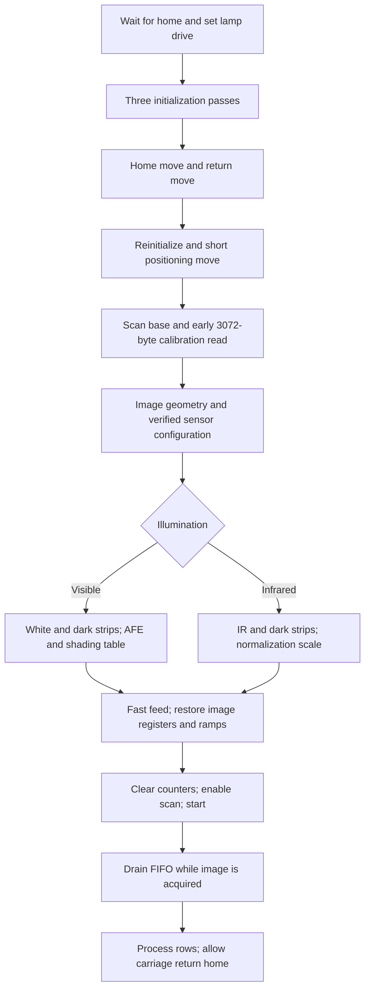

# Plustek OpticFilm 8200i GL128 behavioral specification

Version 1 — 2026-10-07 — USB `07b3:1825`.

## 1. Scope and conventions

This specifies enough device communication and host image processing to
implement the supplied driver's normal scanning behavior independently. It
covers Color, Gray, Infrared, and Color+Infrared; 8/16-bit output; six
resolutions; exposure; cropping; calibration; streaming; and infrared repair.
It describes a transparency scanner, including film borders and positioning
margins. There is no automatic film loading or negative inversion in this
behavior. Negative conversion, film-base removal, profiles, and display gamma
belong to a caller or an additional image-processing layer.

The target is the GL128 device with product ID `1825`. Do not select hardware
solely by the printed model name. The same name also appears on a device
with product ID `130d`; this packet supplies no programming sequence for it.

Requirements called MUST reproduce the packet's specified behavior. SHOULD
identifies an engineering recommendation; it is not a claim about additional
hardware capability. Exact successful-path sequences are retained even when
the meaning of a register is uncertain. Register names here are descriptive;
the supplied bytes and execution order take precedence over names.

All hexadecimal byte sequences are in transmission order. Registers hold
8-bit values. `W(address,value)` means one register write, `R(address)` a
shadow register read, and `H(address)` a live hardware read. `BE20` and `BE24`
mean high/middle/low bytes at three consecutive register addresses, with the
high byte masked to four bits for BE20. `LE32` is a four-byte little-endian
integer in a USB payload. `floor`, `round`, and `clamp` have their usual
mathematical meanings; rounding nonnegative image values means
`floor(value+0.5)`, unless stated otherwise.

The accompanying JSON is normative wire data. Each `hex` string decodes to
`length_bytes` bytes and has the SHA-256 digest recorded beside it. A
`register_pairs` payload is an ordered list of address/value pairs, not a
map: preserve repeated addresses, ordering, and the 64-byte transfer split.
An `afe_index_high_low` payload contains triples; transmit each triple as
one separate AFE transaction as defined in section 2.4. A
`uint16_le_periods` payload is 256 little-endian motor timer periods.

## 2. USB transport

### 2.1 Device and endpoints

| Property | Value |
| --- | --- |
| Vendor ID | `07b3` |
| Product ID | `1825` |
| Control endpoint | EP0 |
| Bulk IN | `81` |
| Bulk OUT | `02` |
| Interrupt IN descriptor | `83`; normal scanning does not read this endpoint |
| Bulk packet alignment used by the driver | 512 bytes |

The transport MUST acquire exclusive usable access to the USB device and
discover/claim the interface exposing these endpoints. This source-derived
packet does not establish a required configuration number, interface number,
alternate setting, or a full-speed operating mode. Those MUST be determined
from descriptors instead of guessed. Device opening itself does not scan or
perform the initialization sequence; initialization runs for each physical
image pass.

### 2.2 Control requests

| Operation | bmRequestType | bRequest | wValue | wIndex | Length/data |
| --- | --- | --- | --- | --- | --- |
| Register write(s) | `40` | `a0` | `0083` | `0000` | Address/value pairs, 2..64 bytes |
| Shadow read of address `aa` | `c0` | `a0` | `008e` | `(aa<<8) \| 22` | 2-byte response |
| Live read of address `aa` | `c0` | `a0` | `018e` | `(aa<<8) \| 22` | 2-byte response |
| Memory DMA setup, write | `40` | `a0` | `0082` | `0001` | `LE32(address),LE32(logical_length)` |
| Memory DMA setup, read | `40` | `a0` | `0082` | `0000` | Same 8-byte encoding |
| Image FIFO chunk setup | `40` | `04` | `0082` | `0000` | `LE32(10000000),LE32(chunk_length)` |
| Lamp drive, first address | `40` | `0c` | `008c` | `0010` | Single byte `0c` |
| Lamp drive, second address | `40` | `0c` | `008c` | `0013` | Single byte `0c` |
| Special interrupt read | `c0` | `a0` | `008a` | `26fe` | 1 byte |
| Special status read | `c0` | `a0` | `008e` | `0000` | 1 byte |

Do not interchange `a0` memory DMA and `04` image FIFO requests: both use
`wValue=0082`, but occur on different paths. Do not encode a register write
address in `wIndex`; the write address is in the payload.

A register read returns `[value,55]`; `55` is ASCII `U`. The baseline accepts
the value even if the confirmation byte differs, with a diagnostic. Transport
failure is separate from a mismatched confirmation byte.

A register list MUST have a positive even length. Split it into at most
64-byte consecutive chunks, with no address/value pair crossing a chunk.
Keep separate writes separate where this specification explicitly uses `W`.

### 2.3 Memory DMA and image FIFO

Memory DMA write: poll `H(18)` until `(value & 0c)==0`; send memory setup;
write bulk data; poll the same condition again. Poll every 20 ms, for a
nominal 833 ms budget (the discrete implementation can reach 840 ms).
Memory transfer lengths are logical lengths. Bulk OUT writes first send the
largest whole multiple of 512 bytes; a remainder is sent in a separate
512-byte block with zero padding. A short write is an I/O failure.

The short positioning move in section 4.4 intentionally omits the readiness
poll before DMA setup. It still waits after each table write.

For image reads, repeatedly choose `chunk=min(remaining,0xeff0)`. If
`chunk>=512`, round it DOWN to a multiple of 512. Thus the largest actual
read request is 60,928 bytes (`0xee00`), although staging storage is
61,424 bytes (`0xeff0`). A final remainder below 512 bytes is requested at
its exact size. Before EVERY bulk IN operation send the image FIFO setup
request. The FIFO address remains `10000000`; do not add an offset to it.
There is no `H(18)` poll between image FIFO chunks.

A positive short image read advances by the number of bytes actually
received; issue a new setup request for the remaining data. Zero bytes or
a failed request is an error. USB chunk boundaries need not coincide with
sensor line or sample boundaries: accumulate bytes across chunks.

Allow 180 seconds for the first image bulk read, then 30 seconds for each
later read. The stationary strips also use the image FIFO mechanism. The
older 30-second first-read limit did not cover all lead-in behavior at high
resolution; retain the longer budget even with fast positioning enabled.

The one early 3,072-byte read in section 4.5 uses memory DMA with request
`a0`, not the image FIFO path. Generic memory bulk reads use a 30-second
timeout, up to 65,536 bytes per call, and 512-byte aligned requests. If a
logical read requires padding, provide scratch storage for the padded read
and retain only the logical bytes.

### 2.4 AFE access

One AFE write of index `ii` and 16-bit value `vv` is the six-byte register
payload `51 ii 5d high(vv) 5e low(vv)` using the register-write request.
Indices `02/03/04` are R/G/B gain codes; indices `05/06/07` are R/G/B
offsets. Gain is a 6-bit field with response:

`gain(code) = 6 / (1 + 5*(63-code)/63)`, for `0<=code<=63`.

The source provides fixed defaults; visible per-scan calibration
subsequently replaces the gain codes. Use
`INITIAL_AFE`, `SCAN_BASE_AFE`, and `VISIBLE_DEFAULT_AFE` at the stages
specified below. A register read of `5e` is not a substitute for reading
the entire indirect AFE state.

## 3. Scan options and geometry

| Option | Values/range | Default |
| --- | --- | --- |
| Mode | Color, Gray, Infrared, Color+Infrared | Color |
| Resolution | 300, 600, 1200, 2400, 3600, 7200 dpi | 3600 |
| Output depth | 8 or 16 bits per channel | 16 |
| Exposure multiplier | 1.0..4.0, step 0.05 | 1.0 |
| IR repair | Boolean, used with Color/Color+Infrared | Off |
| Automatic white balance | Boolean | Off |
| Left/right coordinates | 0..36.5 mm, no quantization step | 0, 36.5 |
| Top/bottom coordinates | 0..27.2 mm, no quantization step | 0, 27.2 |

The hardware always emits three interleaved 16-bit channels, including
Gray and Infrared. Output depth does not change sensor depth. Cropping is
performed on the host after full-window acquisition. It does not alter
hardware feed distance, capture width, or line count.

For requested resolution `dpi`, compute:

| Quantity | Formula |
| --- | --- |
| Sensor resolution selector | `dpi/6`, integer, at registers `2c:2d` high then low |
| Full width | `floor(dpi*36/25)` pixels |
| Vertical acquisition target | `vertical=max(1490,dpi)` |
| Base motor period | `floor(1450*vertical/1490)` |
| Raw capture lines | `max(1,floor(vertical*(24/25.4)*(1+2*0.07)))` |
| Raw bytes per line | `6*full_width` |
| Raw bytes per image pass | `raw_capture_lines*raw_bytes_per_line` |
| Vertical resample ratio | `vertical/dpi` |
| Delivered full height | Raw capture lines if ratio <=1.01, otherwise `max(1,floor(raw_capture_lines/ratio))` |
| Channel displacement | `dpi/300` output rows |
| Exposure register value | `round(14000*exposure_multiplier)` |
| Image motor period requested | `round(base_motor_period*exposure_multiplier)` |

| dpi | Selector | Width | Raw lines | Full output height | Base period |
| --- | --- | --- | --- | --- | --- |
| 300 | 50 | 432 | 1604 | 322 | 1450 |
| 600 | 100 | 864 | 1604 | 645 | 1450 |
| 1200 | 200 | 1728 | 1604 | 1291 | 1450 |
| 2400 | 400 | 3456 | 2585 | 2585 | 2335 |
| 3600 | 600 | 5184 | 3877 | 3877 | 3503 |
| 7200 | 1200 | 10368 | 7755 | 7755 | 7006 |

These are the current code's measured geometry constants and arithmetic,
not a guarantee of optical resolving power. At low requested resolutions,
the motor retains the 1490-dpi acquisition target and the host downsamples
vertically. Above that target the code slows the motor and captures the
additional rows directly; it does not vertically upsample the low-resolution
image. The 7200-dpi timing exception is in section 4.6.

The constant-period table loader accepts requested periods 500..20000
inclusive; otherwise it substitutes 1450. This interacts with the advertised
exposure range: at 7200 dpi, multipliers above about 2.8547 request a period
outside the loader's accepted range. A baseline-compatible implementation
must account for that substitution; the packet does not establish a
geometry-preserving configuration for that combination. An implementation
SHOULD expose the limitation rather than claim that every high-resolution
exposure combination preserves geometry. See section 10.

## 4. Complete physical-pass sequence

Every physical pass runs sections 4.1 through 4.9. A two-pass operation runs
the entire sequence for IR first and then for visible color. Do not reuse
the visible shading table for IR.



### 4.1 Previous return and illumination drive

Poll live status `H(01)` every 20 ms for up to 10 seconds until
`(status & 09)==08`: home sensor set, motor-enable flag clear. This permits
the previous automatic return to finish. If the condition never occurs,
the baseline continues with the explicit homing moves.

Send the two lamp-drive control requests from section 2.2, in order:
address `0010` then `0013`, both with byte `0c`. Both requests are needed
for the measured lamp level. Their effect persists until power-off. This
step is distinct from ordinary register `10/13` writes.

### 4.2 Three initialization passes

1. `W(0e,00)`.
2. Send `INITIAL_REGISTERS` (232 bytes, split 64+64+64+40).
3. Write `10=0e`, `13=0e`, `0b=84`, `13=0f`, `0b=8c`, individually
   in that order; wait 100 ms; write `0a=40`.
4. Individually write GPIO registers in this order:
   `6e=4c`, `6f=80`, `6b=30`, `6c=4c`, `6d=80`, `a6=00`,
   `a7=07`, `a8=20`, `a9=01`.
5. Send the eight `INITIAL_AFE` triples, individually.
6. Read shadow register `8a`.
7. Repeat steps 2 and 3, then send `INITIAL_AFE` again. The GPIO writes
   and shadow interrupt read are not repeated here.
8. Perform the special interrupt read (`008a/26fe`, 1 byte) and special
   status read (`008e/0000`, 1 byte) from section 2.2.
9. Send `INITIAL_REGISTERS` a third time.
10. Write only `10=0e`, `13=0e`, `0b=6c`, individually. This pass omits
    the `0b=84/8c` cycle and the 100-ms post-cycle delay.
11. Send `INITIAL_AFE` a third time; wait 500 ms; write `03=30`.

The three copies of `INITIAL_REGISTERS` precede homing. The separate
250-byte `POST_HOME_REGISTERS` sequence below follows the second move;
these are four full register-loading operations in total.

### 4.3 Home and return moves

Home move: send `HOME_MOVE`; load `HOME_RAMP` to `1000c000` then
`10010000` using ordinary DMA writes; write `0f=01`. Poll `H(01)` every
2 ms until bit 0 clears, with a 20-second budget.

Return move: send `RETURN_MOVE`; load `HOME_RAMP` to the same two
addresses; write `0f=01`. Poll bit 0 clear every 2 ms for up to 15 seconds.
The feed bytes in this block are `02 d9 42`, i.e. `0x02d942` in high-first
register order. Do not reverse them based on older register descriptions.

### 4.4 Reinitialize and short move

Write `10=0c`, `13=0c`. Send `POST_HOME_REGISTERS` as
64+64+64+58 bytes. Send `INITIAL_AFE`. Read `H(01)`, write `03=00`, read
`H(01)`, write `03=20`, then `03=30`; wait 15 ms. The baseline makes two
additional live status reads at this point for diagnostics.

Send `SHORT_MOVE`. Write `SHORT_RAMP` to `1000c000` then `10010000`,
each with DMA setup, bulk OUT, and post-write readiness polling, but
without a pre-write readiness poll. Write `0f=01`; poll `H(01)` bit 0
clear every 2 ms for up to 5 seconds. Do not require home sensor bit 3
to change or add a minimum waiting time before proceeding.

### 4.5 Scan base and early calibration read

Write `d0=d1=d2=0a` individually. Individually write each consecutive
register `e0` through `f8` with these values, in ascending address order:

```text
e0..e7: 00 a8 0b 35 0b 36 15 c3
e8..ef: 15 c4 20 51 20 52 2a df
f0..f7: 2a e0 35 6d 35 6e 3f fb
f8:     05
```

Retain these buffer boundaries for the image pass. Send `SCAN_BASE_1`,
then `SCAN_BASE_2`, then the six `SCAN_BASE_AFE` triples.

Write `0d=05`, `0d=07`, `01=03`, `0f=01`, individually. Poll
`H(01)` bit 0 clear every 2 ms for up to 5 seconds. Wait for memory DMA
ready, set up a 3,072-byte memory READ at `10000000`, and read those
bytes from bulk IN. The baseline discards the data: this is an early
state-transition/calibration acquisition, not the shading calibration
specified in section 5.

Load a 512-byte constant-period table into `10000000`, `10004000`, and
`10008000`, in order, using the base period in section 3. Write `03=30`,
`01=02`, then send `CLEAR_INTERRUPTS`.

### 4.6 Image-pass registers

Send one register list with fields in this order:

| Addresses | Value |
| --- | --- |
| `7d:7e:7f` | BE24 exposure value |
| `25:26:27` | BE20 raw capture line count |
| `2c:2d` | High/low 12-bit resolution selector |
| `35:36:37` | `2f 04 c0` |
| `3d:3e:3f` | BE20 `15380` (`00 3c 14`) |

The `35:36:37` constant is retained as a known-working setting. Do not
replace it with bytes-per-line; the packet does not establish that as its
meaning. Bit 2 of register `37` is also the IR illumination control.

Send `VERIFIED_SENSOR` after this list. Its clock, sampling, and AFE
timing values MUST be treated as a matched set. In particular, `55=02`
is the baseline green sample point, `06=f0` the sensor mode, and
`70:71:72:73=0a:0b:0c:0d` the clock sequence. Leave the resolution
selector from the dynamic list intact.

Send `VISIBLE_DEFAULT_AFE`. For an IR pass, after those writes:

1. Read register `37` and set bit `04`, preserving the other bits.
2. Read register `03`, clear bit `10`, and set bit `20`, preserving the
   other bits. This disables the visible lamp while selecting transparency.
3. Write IR-specific AFE gain codes `01/01/01` at indices `02/03/04`,
   with high data byte zero. Retain the offset settings.

For 7200 dpi only, then send the following register list, after the
verified sensor and AFE configuration:

`28=00,29=3e,2a=5b,2b=17,a5=01,ab=01`.

It sets the line-timing value to 15963 and must not be overwritten by
the earlier sensor list (`2a=3b,2b=02`). Other resolutions retain
`28:29:2a=00:2b:3b` from the preceding configuration.

Load the three constant-period tables again, using the exposure-scaled
image period from section 3. Each is 512 bytes: 256 copies of the
selected period in little-endian order. Use addresses `10000000`,
`10004000`, and `10008000`. Then individually write, in order:

```text
02=30
21=10,22=7f,23=7f,24=10,69=10
60=40,61=00,62=00,63=40,64=00,65=00
80=ff,67=7f,68=7f
```

Quarter-step selection `60=40,63=40` and these motor tables form one
configuration. The image phase uses exactly the raw line count in
section 3; no line-count safety multiplier is added.

### 4.7 Per-pass calibration

For visible Color or Gray, perform section 5 and mark shading valid only
if it succeeds. For IR, perform section 6; shading remains disabled.
The routines restore image line count, feed distance, exposure, and
constant-period tables after the stationary measurements.

### 4.8 Fast positioning feed

The baseline replaces the image's long slow feed with a fast 14,860-step
positioning move (`15380-520`), then sets image FEEDL to 1. This occurs
after stationary calibration and before image START.

Save shadow values for all addresses in `FEED_SAVED_ADDRESSES` (42
addresses). Send `FEED_REGISTERS`, with registers `3d:3e:3f` patched to
BE20 `14860` (`00 3a 0c`) and its last pair patched to `af=ff` for the
fast ramp. Load `FEED_FAST_RAMP` into `1000c000` and `10010000` using
ordinary DMA writes; write `0f=01`.

Poll `H(01)` every 2 ms with a 15-second wall-clock budget. First
observe running: bit 0 set OR bit 5 clear. Only after that observation
accept completion: bit 5 set AND bit 0 clear. This avoids accepting a
stale completion flag from the preceding movement. Upon timeout write
`02=00` and return I/O failure. Upon success send
`02=08,3d=00,3e=00,3f=01`.

Restore the saved register list in its original address order, split
into 64+20 bytes. Restore `SHORT_RAMP` to both fast-table addresses.
Then send `3d=00,3e=00,3f=01` for the image pass.

The generic feed primitive accepts 1..28292 steps. With the slow ramp,
use `FEED_SLOW_RAMP` and retain `af=7f`; with the fast ramp use
`FEED_FAST_RAMP` and `af=ff`. The normal image path always uses the
14,860-step fast feed. The 520-step conversion is empirical and is part
of this baseline's frame positioning.

### 4.9 Start, read, and finish

Write `0d=05`, then `0d=07`. Write `01=23` when the visible shading
table is valid, otherwise `01=03`. Write `0f=01` to start acquisition.

Immediately begin image FIFO reads as defined in section 2.3; read
`full_width*6*raw_capture_lines` bytes for full-window acquisition.
Do not wait for the motor to finish before reading. Image data can
exceed the circular device buffer and the acquisition can stall while
waiting for the host to drain it.

After full acquisition, clear register `01` bit 0 using a shadow
read/modify/write, preserving other bits. Thus `23` becomes `22` and
`03` becomes `02`. Permit the configured automatic return home. Do not
turn off motor power on ordinary EOF or after delivery from a completed
in-memory image. The next physical pass performs section 4.1's home
and idle wait.

A streaming implementation may deliver a crop before reading the whole
frame. The baseline clears SCAN when the final cropped output row has
been delivered, even if later raw rows were not drained. Treat that as
an early finish rather than full-window acquisition; retain the home
and idle wait before the next pass. Exact behavior of all residual
FIFO states in that early-finish case is not independently established.

## 5. Visible calibration and hardware shading

### 5.1 Stationary-strip acquisition

A strip is 128 lines of the image pass's current horizontal width,
three 16-bit channels per pixel. Mean each sample position over all
128 lines. Before visible strips set:

`25:26:27=00:00:80`, `3d:3e:3f=00:00:01`,
`7d:7e:7f=00:36:b0` (14000), `02=00`, `01=02`.

Set all three AFE gain codes to 0. For a white strip write `03=30`;
for a dark strip write `03=20`. Wait 300 ms after setting the lamp.
For each strip write `0d=05`, `0d=07`, `01=03`, `0f=01`, read
exactly `128*width*6` FIFO bytes, then write `01=02`.

Take white strips repeatedly, at most eight. Sum each channel over
the mean line, and compare with the preceding strip. Stop when the
largest channel-relative change is strictly below 0.002. There is no
preceding sample on the first iteration, so at least two are taken.
Use the last strip even if eight attempts do not converge, and report
the drift. Then acquire a dark strip at gain 0.

Let `light[x,c]=white_mean[x,c]-dark_mean[x,c]`. The 99th percentile
of a class means sorting its values ascending and selecting index
`min(count-1,floor(count*0.99))`, with zero-based indexing.

For each channel compute `top[c]=p99(light[:,c])`. Reject shading if
any channel's raw white peak exceeds 65000 or `top[c]<1000`. This
check occurs before setting the final gain codes.

### 5.2 Gain selection and digital trim

For each channel choose the smallest 6-bit gain code for which
`gain(code)>=0.90*65535/top[c]`; if none exists below 63, use 63.
Then calculate:

`trim[c] = (0.90*65535)/(top[c]*gain(code[c])/gain(0))`.

Write the chosen codes and acquire another dark strip with the lamp
off. This final dark strip supplies the shading dark terms. The
illumination profile remains the earlier low-gain light profile.
Calibrating at base exposure, then restoring the requested image
exposure, makes the per-scan visible gain selection independent of
the requested exposure multiplier.

### 5.3 Per-pixel table

The two CCD taps are treated independently for shading. Partition the
RGB-interleaved sample indices into six classes by `sample_index % 6`
(even/odd pixel and color). For each class let `reference` be its
99th percentile of the low-gain light profile. Assign:

`shading_gain = 8192`, if `reference<1000` or `light<0.5*reference`;
otherwise `shading_gain = reference*8192/light*trim[color]`.

Each pixel's table record is twelve bytes:

`LE16(dark_R),LE16(gain_R),LE16(dark_G),LE16(gain_G),LE16(dark_B),LE16(gain_B)`.

Each term is rounded to the nearest integer and clamped to 0..65535.
After every 42 pixels insert eight zero bytes, including after the
last pixel if the width is an exact multiple of 42. The logical size is
`floor(width/42)*512 + (width%42)*12`. DMA-write that logical table
to `10014000`; bulk OUT adds final transport padding as in section 2.3.
8192 is the unity gain encoding. The packet establishes the table
format and measured use, not the ASIC's complete internal clipping or
rounding rules.

### 5.4 Restoration and fallback

After success or failure, write `03=30`, wait 100 ms, restore image
LINCNT, original FEEDL=15380, and image exposure. Reload the three
exposure-scaled constant-period motor tables; write `02=30`, `01=02`.
Use DVDSET (`01` bit `20`) for the image only when table construction
and upload succeeded. On unusable strips or calibration failure the
baseline continues without shading, using `01=03` at image START.
The exact final AFE gains in a failure case depend on the stage reached.

## 6. Infrared reference

IR uses a separate physical pass with the visible lamp off, register
`37` bit `04` set, and its own gain codes. It still returns three
interleaved sensor channels; hardware shading MUST remain disabled
because this baseline's visible shading configuration clips IR.

At the requested image exposure and IR gain codes, temporarily set
LINCNT=128, FEEDL=1, motor control `02=00`, and scan control `01=02`.
Set IR LED bit `04` in register `37`, wait 300 ms, and acquire a
stationary strip using section 5.1's counter/START/FIFO sequence.
Clear that LED bit, wait 300 ms, acquire a dark strip, then restore
the LED bit. The visible lamp remains off for both strips.

Use green sample positions only. Compute `light_G=IR_mean_G-dark_mean_G`
and its 99th percentile `top`. If the raw IR green peak exceeds 65000
or `top<1000`, leave the normalization scale at 1.0 and report failure.
Otherwise set `IR_scale=58000/top`.

After success or failure, set IR LED on, restore image line count,
FEEDL, exposure, and constant-period tables, then `02=30`, `01=02`.
The image is normalized in software using the mean of its registered
R/G/B channels multiplied by this scale, as specified in section 7.

## 7. Image reconstruction

Decode each incoming sample explicitly as little-endian unsigned
16-bit. Raw pixels are contiguous `R,G,B` triples, and rows are
`width*6` bytes. There is no fourth interleaved IR component, packet
header in bulk data, sensor desegmentation, or demosaic stage in this
verified configuration. Store arithmetic samples in a representation
independent of host byte order.

The following processing order defines the output:

1. **Vertical area resampling.** If `ratio<=1.01`, retain rows directly.
   Otherwise output row `y` integrates raw row intervals overlapping
   `[y*ratio,(y+1)*ratio)`. Weight raw row `i` by
   `max(0,min(i+1,(y+1)*ratio)-max(i,y*ratio))`. Divide the weighted
   sum by the sum of weights, then round and clamp to 16-bit. Do this
   separately for every R/G/B sample. Use the full output height from
   section 3, dropping any fractional tail beyond those rows.
2. **Color-line registration.** Let `shift=dpi/300`. Output red row
   `y` comes from resampled red row `max(0,y-shift)`; green comes
   from row `y`; blue comes from row `min(height-1,y+shift)`. Repeat
   edge rows. Registration follows resampling, so its shift is measured
   in delivered-resolution rows, not raw rows.
3. **Horizontal mirror.** Reverse pixel order within each row, keeping
   the three channels of each pixel together.
4. **Optional automatic white balance.** For a buffered visible image,
   find the full-frame mean of each channel before cropping. Set target
   to the largest mean and multiply each channel by target/its mean,
   rounded and clipped to 65535. It is off by default. Color+Infrared
   ignores this option because its visible frame uses the streaming path.
   Behavior for an all-zero channel is not defined by this packet.
5. **Output-channel selection.** Color keeps R/G/B. Gray uses
   `floor((299*R+587*G+114*B)/1000)`. Infrared uses
   `clamp(round(((R+G+B)/3.0)*IR_scale),0,65535)`.
6. **Optional IR repair.** Apply section 8 to the registered, mirrored
   full color image before cropping. IR reference planes use the same
   geometry and registration. Preserve a separate original IR plane
   when it must be delivered as a second frame.
7. **Crop.** Apply the output-space rectangle below.
8. **Depth conversion and serialization.** For 8 bits, deliver each
   sample's high byte (`value>>8`). For a SANE-compatible 16-bit
   interface, deliver samples in native host byte order. Wire sensor
   data remains little-endian regardless of host. File formats and
   network clients may require a different byte order at their boundary.

For a crop at `dpi`, set `scale=dpi/25.4`. Compute left/top using
`floor(mm*scale)`; right/bottom using `round(mm*scale)`. A right value
at its advertised maximum 36.5 mm means the exact full width; a bottom
value at 27.2 mm means the exact full height. Preserve this special
case even if millimeter arithmetic predicts fewer pixels.

Clamp left to `[0,width-1]`, top to `[0,height-1]`, right to at most
width, and bottom to at most height. If right<=left set right=left+1;
if bottom<=top set bottom=top+1. The rectangle uses exclusive
right/bottom bounds and is always at least one pixel. IR pre-passes
retain the full uncropped plane at 16 bits regardless of output depth.

## 8. Infrared repair

IR repair is optional host processing, not an ASIC command. For Color
with repair enabled, acquire the full 16-bit IR plane FIRST, then the
visible color pass. Matching geometry is required; skip repair if the
IR plane cannot cover the visible full frame. Cancellation of the IR
pass cancels the operation. Ordinary IR-prepass failure in repair-only
mode permits a visible image without repair; Color+Infrared treats
that failure as fatal because its second frame is required.

### 8.1 Interior and local illumination

Use the full registered, mirrored IR plane. Histogram medians here
are the smallest unsigned 16-bit value whose cumulative count is at
least `floor(sample_count/2)`.

Compute its global median; set `limit=floor(global_median/2)`. Find
the first and last rows where more than half the row's samples are
strictly above limit. Within those rows find the first and last
columns where more than half the column's samples are above limit.
These define an exclusive-bounds rectangle. A bound not found retains
the corresponding full-frame bound. If its area is below 1024 pixels,
skip repair. If both dimensions exceed 64, trim two pixels from every
edge before constructing the local profiles.

For each interior column compute the mean IR value over its rows.
Box-smooth the column profile with replicated edge positions; width
is `max(31,floor(interior_width/16))` made odd by setting its low bit.
Clamp each smoothed column mean to at least 1.0.

For each interior row average `IR(x,y)/smoothed_column(x)` over the
columns. Box-smooth that row profile with replicated edges and odd
width `max(31,floor(interior_height/16))`. Clamp it to at least `1e-6`.

### 8.2 Defect threshold

Histogram the normalized values
`floor(clamp(IR/(column_profile*row_profile)*32768,0,65535))` over
the trimmed interior. Let `median` be its histogram median and `mad`
the histogram median of absolute deviations from that median, with
`mad=max(1,mad)`. The deviation used here is unscaled MAD; do not
multiply it by 1.4826.

Set `fraction=(median-10*mad)/32768`. Mark a pixel defective when its
original IR value is strictly less than
`column_profile(x)*row_profile(y)*fraction`. Pixels outside the
interior are not repaired. A negative fraction naturally marks no
nonnegative IR samples. Retain the original plane for export; an
internal defect mask may use 0 for defective and 65535 for clean.

### 8.3 Horizontal interpolation

For each row in the interior, find consecutive runs of defective
pixels `[start,end)`. Leave a run unchanged if its length exceeds
`floor(interior_width/32)`. Otherwise interpolate each color channel
between the clean values immediately before and after the run.
If only one neighbor lies within the interior, use its value at both
ends. If neither exists, leave the run unchanged.

For defective pixel `x`, set
`low + trunc_toward_zero((high-low)*(x-start+1)/(end-start+1))`.
Use sufficiently wide signed intermediate arithmetic. This rule
preserves the baseline's integer rounding, including a descending
gradient. Runs are not dilated and no vertical inpainting is applied.

## 9. Delivery, lifecycle, and optional SANE interface

A driver may use a full image buffer or a bounded raw-line ring.
Streaming and buffered processing MUST agree on the reconstruction
formulas and rounding. Raw-line storage must retain enough history
for red's backward displacement, blue's lookahead, and partial area
averaging, plus one maximum USB chunk of read-ahead. Do not overwrite
a line that a future output row still needs. USB chunk accumulation
must work even when a chunk ends in the middle of a line.

Streaming is the normal visible delivery mode. A full image is needed
for automatic white balance. The IR pre-pass can be reconstructed
through a streaming raw ring, but must keep the full resulting 16-bit
single-channel plane. Color+Infrared delivers its visible image through
streaming and retains the original IR plane separately from any repair
mask. Full buffering is also useful for raw dumps or equivalence checks.

For a SANE-compatible interface:

- Color is one RGB frame, last-frame true. Gray and Infrared are one
  gray frame, last-frame true.
- Color+Infrared physically scans IR first, then color, but delivers
  RGB first with last-frame false. After its EOF, the next start call
  exposes the stored gray IR frame with last-frame true, without a
  further hardware scan. Both use the same crop, width, height, and
  selected depth.
- Bytes per output line are `cropped_width*channels*(depth/8)`.
  Pre-start parameter queries MUST predict the same dimensions as
  actual delivery. Return the current frame's parameters while active.
- Allow arbitrary positive caller read-buffer sizes, including a
  partial output row or partial serialized sample. Set returned length
  on all success and error paths. EOF has zero bytes once the frame
  has been fully delivered; a successful final data return may precede it.
- Refuse a second simultaneous open of the same physical device as
  device-busy. An explicit unmatched device name is invalid; an empty
  name or backend name selects the default device.
- Keep options immutable during active acquisition/delivery. Validate
  option lists/ranges; constrained values report inexact adjustment.
  Mode, resolution, depth, and geometry changes reload parameters;
  a mode change can also reload option descriptors. Group descriptors
  have no settable value. Automatic option actions are unsupported.
- Mark repair and automatic white balance inactive in Infrared mode.
  Gray uses no IR pre-pass even if its repair option was enabled.
- Blocking reads are supported. Nonblocking reads and a selectable
  file descriptor are not supplied by this baseline.

Cancellation MUST serialize with in-flight USB operations. If another
thread or signal requests cancellation during a bulk read, record the
request and stop after the transfer returns; do not race another control
request against it. The baseline checks cancellation between image
chunks, not throughout every initialization move or calibration strip.

For cancellation while acquisition remains active, stop the scan, write
`0f=00`, clear scan-control bit 0, and clear motor-control register `02`
bit `10`, preserving other bits. The baseline then clears register
`6c` mask `55`, register `a5` mask `20`, and register `ab` mask `30`
using shadow read/modify/write, in that order. These GPIO masks are
baseline cleanup behavior; their complete electrical meanings have
not been established by the supplied code. Drop pending image/IR
storage and report cancellation. A close releases all pass storage
and the USB handle. Cancellation after completed acquisition should
only discard host storage, permitting automatic carriage return.

The driver reads no per-user calibration file and no environment
variable. The visible AFE values start from `VISIBLE_DEFAULT_AFE` and
are replaced by the per-scan calibration; the IR gains are fixed at
`01/01/01`.

## 10. Qualification and error policy

This packet describes the verified-sensor path, the only sensor
configuration the driver implements. The older sensor profile and the
debugging overrides of earlier versions have been removed, so there are
no alternative configurations to conform to.

The reference is permissive about several failures: lamp-drive errors,
some initialization/GPIO/status operations, move-table loading, move
poll timeouts, and the early calibration read may only be logged before
continuing. Visible shading and IR-reference failures are nonfatal
fallbacks. A buffered image-read failure may return a zero-padded partial
image for analysis; a streaming image-read failure aborts and cleans up.
These are implementation policies, not evidence that failed hardware
transactions can safely be omitted on the successful path.

An independent driver SHOULD distinguish unusable calibration from
failed USB communication and should report an incomplete image as an
error. If exact failure-policy parity is required, preserve the
differences just described and qualify partial images explicitly.
Do not turn a source comment about continuing on an error into a
claim that a table upload or movement completed.

The following remain qualified:

- Register meanings outside the measured roles and sequences are not
  established by this packet. In particular, register descriptions
  of other Genesys ASICs (including the older GL845) may conflict with
  this GL128 configuration.
- At 7200 dpi and exposure multipliers that request periods above
  20000, the table loader falls back to 1450; no corrected high-exposure
  geometry has been established here.
- Raw samples must be explicitly decoded as little-endian on all
  hosts. Native-order SANE output is a separate boundary; the reference's
  direct raw-word casts do not establish big-endian-host correctness.
- Streaming a short vertical crop can finish before all raw data is
  drained. Repeated-scan behavior should be tested for this condition.
- Concurrent multi-device scanning, non-default USB configurations,
  optical resolution/accuracy, and other scanner revisions require
  additional validation; this packet does not supply those results.

Use [CONFORMANCE.md](CONFORMANCE.md) for offline protocol and image
checks, followed by hardware acceptance against the supplied working
driver. The owner's verification is the baseline evidence of physical
operation; this specification's extraction did not exercise the scanner.
